<div align="center">

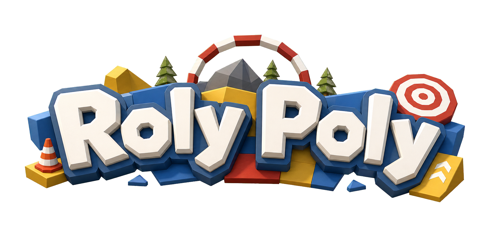

# Roly-Poly

**물리 기반 경쟁 멀티플레이 파티 게임**

Unity Netcode 실시간 경기 · Express 방 목록 API · AWS EC2 데디케이티드 서버

2026 동양미래대학교 졸업작품 · Team GreenCamp

<br/>


</div>

---

## 🎮 플레이 영상

[](https://youtu.be/5tO9JZlhTJI)

> 썸네일을 클릭하면 유튜브에서 플레이 영상을 볼 수 있습니다. ▶️ https://youtu.be/5tO9JZlhTJI

## 소개

**Roly-Poly**는 동물 캐릭터를 조작해 상대와 겨루는 **물리 기반 경쟁 멀티플레이 게임**입니다. 이동·점프·돌진·던지기로 다른 플레이어와 부딪치며 모드별 목표를 달성하고 순위를 겨룹니다.

| | |
|---|---|
| **장르** | 물리 기반 경쟁 게임 — 플레이어끼리 실시간으로 상호작용 |
| **플레이 목표** | 상대를 밀어내거나 장애물을 통과해 각 모드의 승리 조건 달성 |
| **플랫폼** | PC — 방을 만들거나 참가해 함께 경쟁 |

## 3가지 경쟁 모드

맵마다 서로 다른 목표로 순위를 겨룹니다.

| 모드 | 규칙 | 씬 |
|------|------|----|
| **서바이벌** | 2분 동안 생존하며 코인을 수집. 종료 시 생존자의 코인 점수로 순위 결정. 범퍼·폭탄이 상대를 날려 보냄 | `Survival Arena` |
| **떨어지는 바닥** | 밟으면 떨어지는 4층 발판을 옮겨 다니며 추락을 피하고 마지막까지 생존 | `Falling Floors` |
| **장애물 레이스** | 코스의 장애물을 통과하고 결승점에 도착한 순서로 순위 결정 (제한시간 240초, 체크포인트 리스폰, 실시간 순위표) | `Obstacle Race` |

## 플레이 흐름

```
로비 준비            →        경쟁 플레이           →        결과 확인
방 참가·캐릭터 선택           이동·점프·돌진·던지기             모드 규칙으로 순위 결정
맵 선택·준비 완료            모드별 목표 달성                 시상대 연출 → 로비에서 다음 경기
```

탈락한 플레이어는 관전 모드로 남은 경기를 지켜보고, 경기가 끝나면 상위 3명이 시상대에 오릅니다.

## 조작법

| 동작 | 키 |
|------|----|
| 이동 | `W` `A` `S` `D` / 방향키 |
| 점프 | `Space` |
| 달리기 | `Left Shift` |
| 돌진 | `F` |
| 잡기 (플레이어·물체) | 마우스 오른쪽 |
| 던지기 | 마우스 왼쪽 |
| 상호작용 | `E` |
| 관전 대상 전환 | `A` / `D` (탈락 후) |
| 일시정지 메뉴 | `Esc` |

> 키 매핑은 [`Assets/InputSystem_Actions.inputactions`](Assets/InputSystem_Actions.inputactions) 기준입니다.

## 시스템 구조

방 목록은 REST API로, 실시간 경기는 Netcode로 분리했습니다.

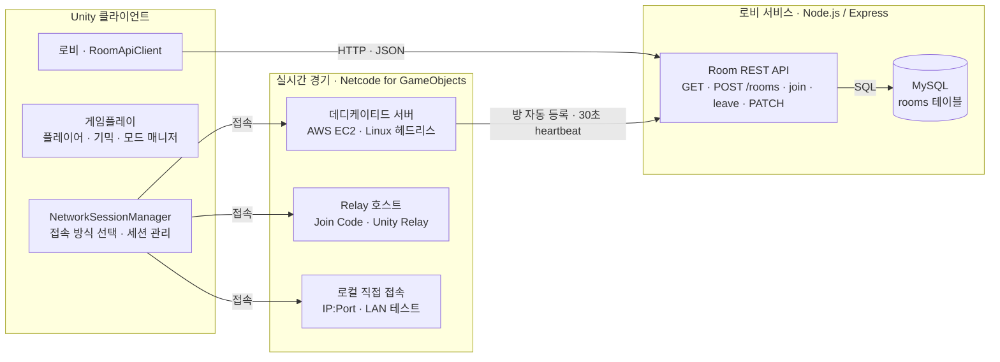

### 접속 방식

| 방식 | 설명 |
|------|------|
| **데디케이티드 서버** | AWS EC2 Linux 헤드리스 서버. 클라이언트는 방 목록에서 공인 `IP:Port`로 직접 접속 |
| **Relay 호스트** | 호스트가 Join Code를 발급하고 Unity Relay를 경유해 접속 |
| **로컬 직접 접속** | `IP:Port`를 입력해 접속 (개발·LAN 테스트) |

### 방 목록 REST API

| Method | Endpoint | 설명 |
|--------|----------|------|
| `GET` | `/rooms` | 공개 방 목록 조회 |
| `POST` | `/rooms` | 방 생성·접속 정보 저장 |
| `POST` | `/rooms/:id/join` | 정원 확인 후 입장 |
| `POST` | `/rooms/:id/leave` | 퇴장, 빈 방 자동 삭제 |
| `PATCH` | `/rooms/:id` | 인원·상태 등 방 정보 수정 |

## 핵심 구현

### 1. 플레이어 간 물리 상호작용

플레이어는 각자 자기 캐릭터만 움직이는 Owner 권한 구조라, 상대에게 주는 효과는 서버를 거쳐 전달합니다.

```
공격자 화면                    서버 검증                         피해자 화면
충돌·접촉 감지              →  두 플레이어 거리,              →  피해자 소유자에게만 ClientRpc
자기 효과(바운스·돌진 가속)      힘·스턴 시간 상한 재확인            넉백·넘어짐을 로컬 물리로 적용
즉시 적용 후 서버에 요청         조작된 요청 차단
```

| 상호작용 | 구현 |
|----------|------|
| 머리 밟기 | 스턴(찌부) 상태를 서버가 `NetworkVariable`로 동기화 |
| 돌진·밀치기 | 피해자 소유자에게만 넉다운 ClientRpc 전달 |
| 잡아 던지기 | Rpc가 변수보다 먼저 도착해 던지기가 무시되던 문제 해결 |
| 물체 던지기 | 실제 속도를 가진 서버가 충돌을 감지해 피해자에게 전달 |

### 2. 서버 판정과 배포

중요한 판정은 서버가 확정하고, AWS EC2에 헤드리스 서버를 올려 운영합니다.

**서버 판정**
- **히트 재검증** — 클라이언트가 보고한 공격을 서버가 거리·힘·스턴 시간 상한으로 다시 확인
- **요청자 식별** — Rpc 인자가 아닌 `SenderClientId`로 판별해 다른 플레이어 대리 조작 차단
- **경기 판정** — 레이스 게이트 통과·탈락·코인 순위를 서버가 확정하고 시상대에 반영

**데디케이티드 서버 (AWS EC2)**
- **헤드리스 Linux 서버** — Relay·로컬 접속에 더해 EC2 서버 지원, 실행 인자로 포트·씬 지정
- **방 목록 자동 등록** — Node.js API에 공인 `IP:포트`를 등록하고 접속 인원을 실시간 갱신
- **중복 방 정리** — 재시작 시 같은 주소의 옛 방을 닫고 30초 주기 heartbeat로 상태 유지

```bash
./server.x86_64 -batchmode -nographics -dedicatedServer -port 7777 -scene "Survival Arena" \
  -apiUrl <백엔드 URL> -publicIp <EC2 공인 IP> -roomName <방 이름>
```

### 3. 경기 프레임워크

`SurvivalGameManager`가 모드와 무관한 공통 흐름(대기·카운트다운·경기·종료, 탈락·승자 판정, 관전, 승수 집계, 시상대)을 맡고, **모드 하나 = 씬 하나**로 확장합니다. 서바이벌은 `timedCoinSurvival`, 레이스는 `raceMode` 옵션으로 규칙을 바꿉니다.

### 추가 구현

- **서든데스** — 일정 시간 후 바깥 발판부터 붕괴해 교착 방지
- **관전·시상대** — 탈락 후 관전 모드(닉네임 표시, 대상 전환), 순위별 결과 화면과 시상대 연출
- **설정·편의 기능** — 음량·감도·해상도·화질·언어(한국어/영어) 설정 저장, 닉네임 변경
- **접속 처리** — 연결이 끊기면 이유를 보여주고 로비로 복귀

## 기술 스택

| 구분 | 사용 기술 |
|------|-----------|
| 게임 엔진 | Unity 6 (6000.3.10f1) · C# · URP · Cinemachine · Input System · ProBuilder |
| 멀티플레이 | Netcode for GameObjects 2.10 · Unity Relay (Multiplayer Services) |
| 백엔드 | Node.js · Express · MySQL (방 목록 REST API) |
| 클라우드 | AWS EC2 · Linux 헤드리스 데디케이티드 서버 |
| UI | Heat - Complete Modern UI (UGUI) · 한국어/영어 로컬라이즈 |
| 형상관리 | Git · GitHub |

## 프로젝트 구조

```
Battle-Royal/
├── Assets/
│   ├── Scripts/
│   │   ├── Player/                  # 이동·균형·접지·돌진·잡기·넉백·리스폰·애니메이션
│   │   ├── Network/                 # 세션 매니저, 방 API 클라이언트, 데디 서버 부트스트랩·방 등록
│   │   ├── Gameplay/
│   │   │   ├── Survival/            # SurvivalGameManager(모드 공통), 코인·레이스·관전·HUD
│   │   │   └── ...                  # 체크포인트, 리스폰 위험지역, 피격 연출
│   │   ├── Interactable/            # 범퍼·폭탄·떨어지는 발판·레이스 장애물·잡을 수 있는 물체
│   │   ├── UI/ · Settings/          # 일시정지·닉네임·로컬라이즈, 설정·사운드
│   │   └── *UIController.cs         # 타이틀 / 로비 UI
│   ├── Scenes/                      # Title, Lobby, Survival Arena, Falling Floors, Obstacle Race
│   └── Prefab/ · UI/ · Animations/ · Resources/
├── backend/                         # Node.js + Express + MySQL 방 목록 서버
├── docs/slides/                     # 발표 자료 슬라이드
├── Packages/
└── ProjectSettings/
```

## 실행 방법

**클라이언트** — Unity 6000.3.10f1로 프로젝트를 열고 `Assets/Scenes/Title Scene.unity`에서 플레이합니다.

**백엔드** — 자세한 내용은 [`backend/README.md`](backend/README.md)를 참고하세요.

```bash
cd backend
npm install
npm run dev
```

## 개선 방향

- **접속 안정성** — 지연·접속 실패·중도 이탈 상황 점검
- **플레이 피드백** — 실제 플레이 의견으로 모드와 연출 개선
- **폴리싱** — UI·비주얼 버그 수정, 테스트를 통한 엣지 케이스 보완

## 발표 자료

<div align="center">

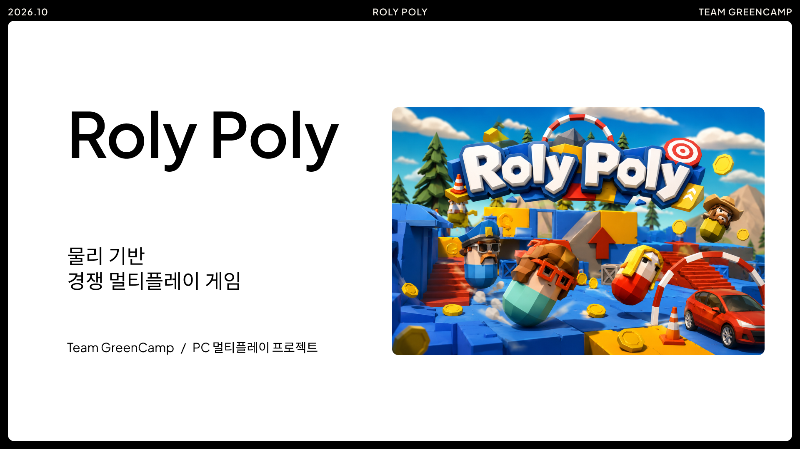
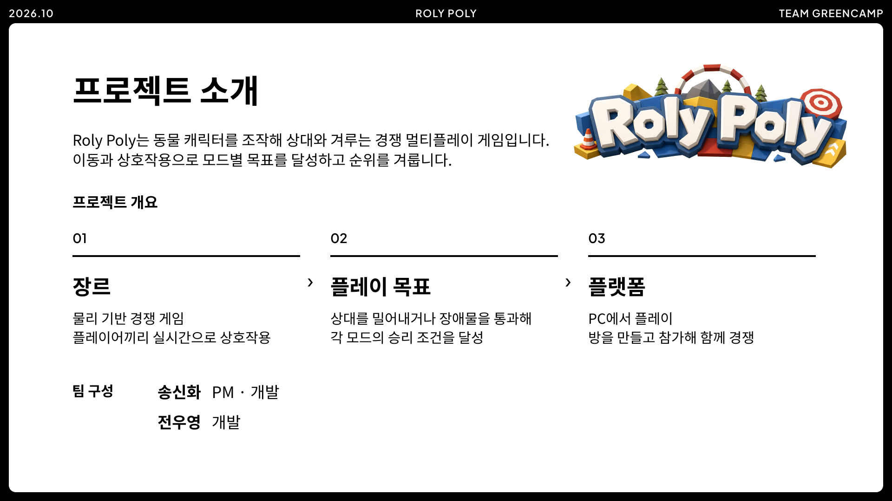
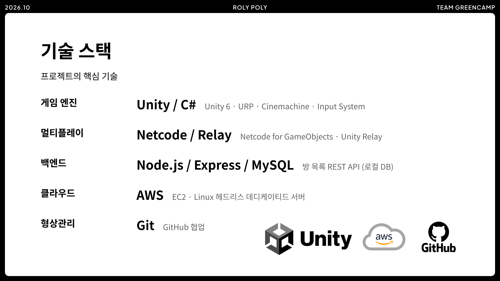
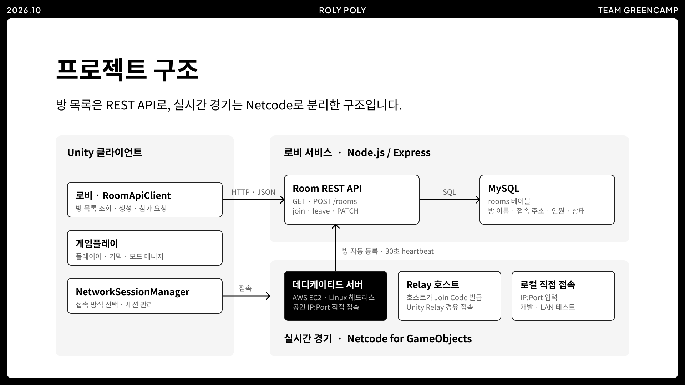
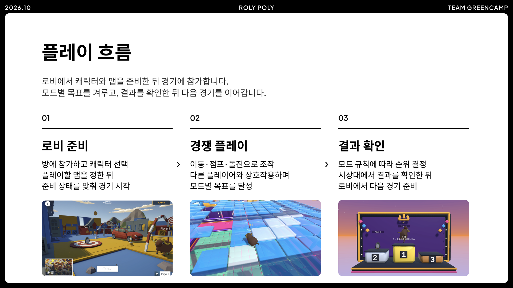
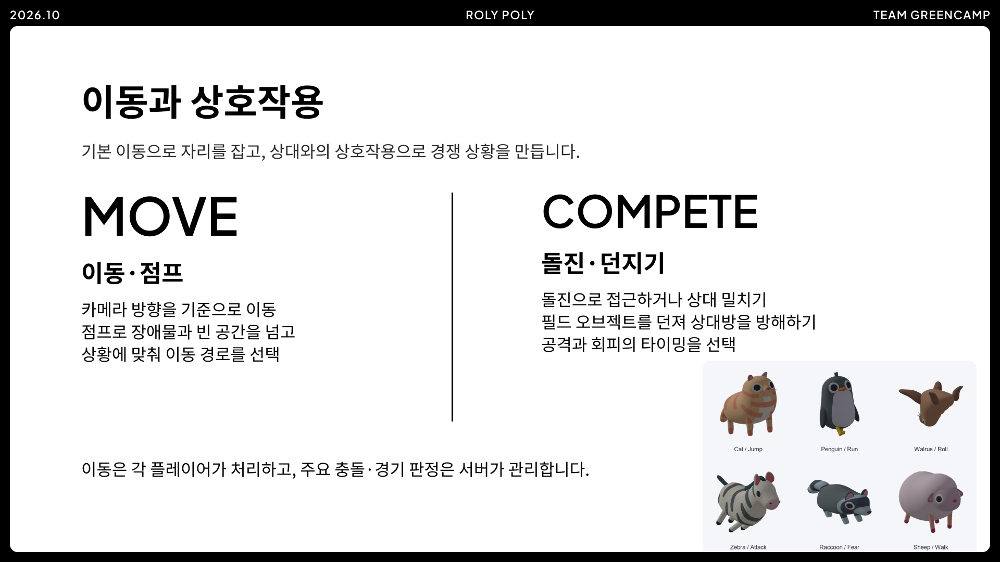
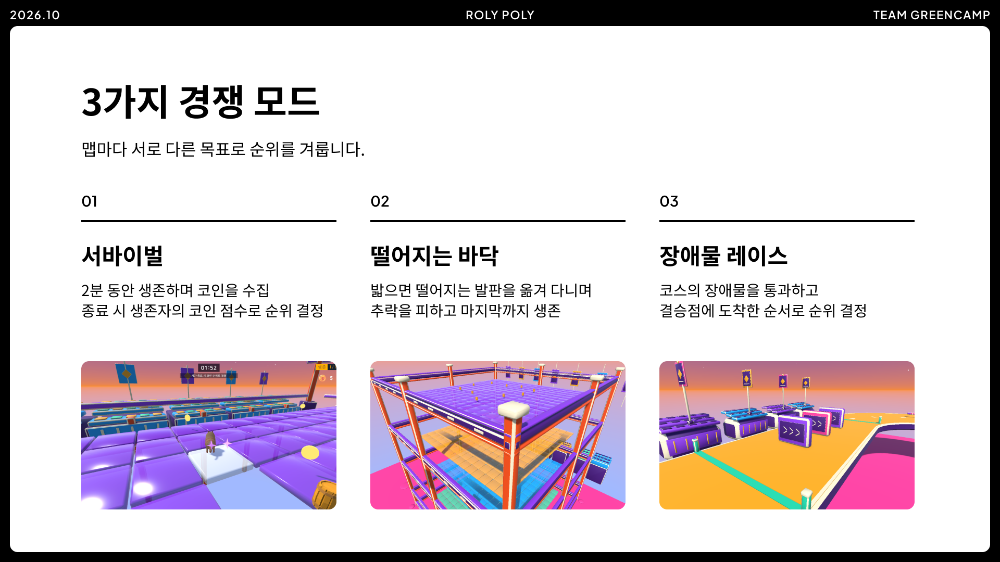
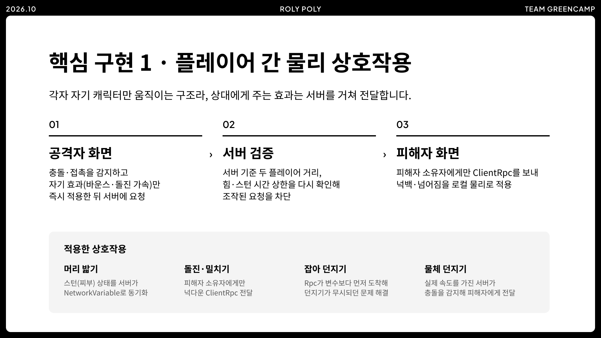
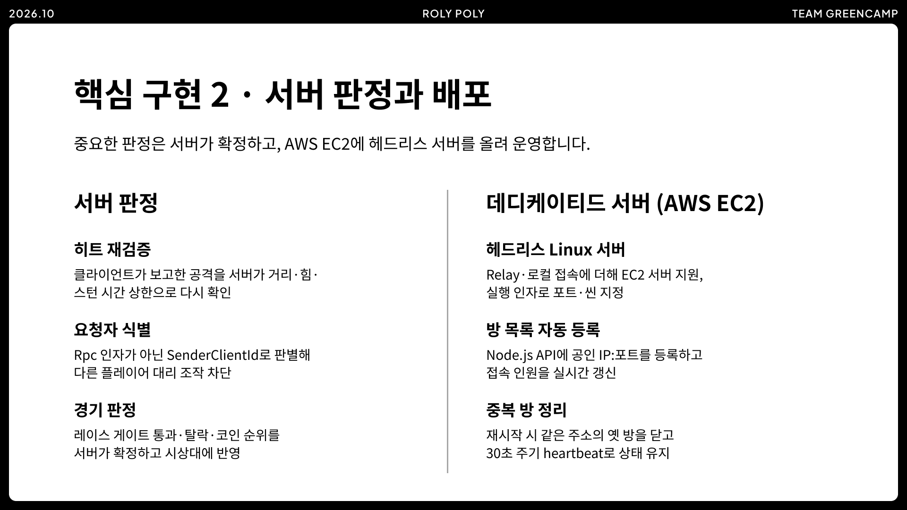
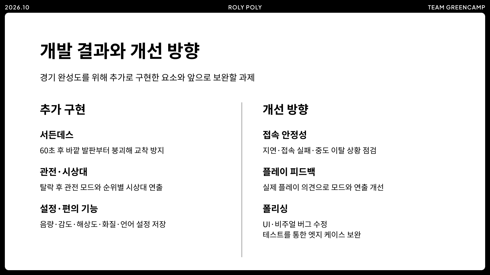
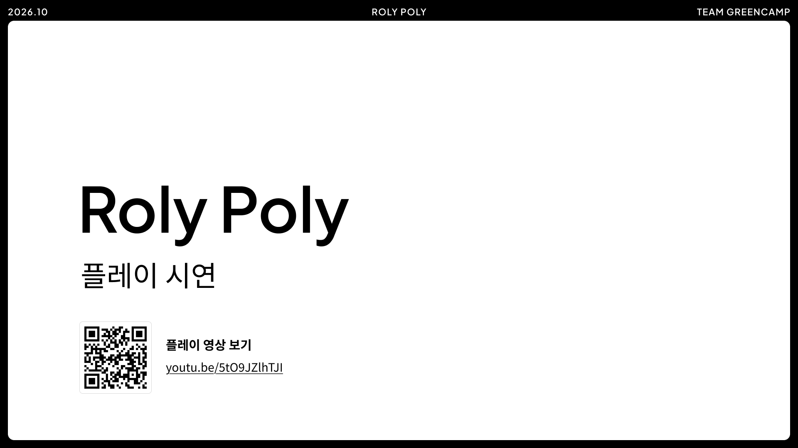

</div>

## 팀

**Team GreenCamp**

| 이름 | 역할 |
|------|------|
| 송신화 | PM · 개발 |
| 전우영 | 개발 |

---

<div align="center">

2026 동양미래대학교 졸업작품 · Team GreenCamp

</div>
